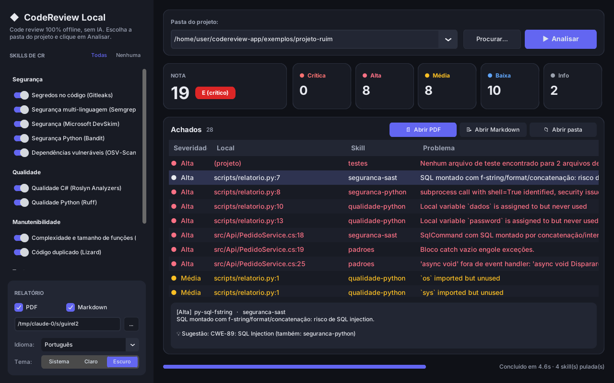

# CodeReview Local

[](https://github.com/MateusKraiewski/CodeReview-App/releases/latest) [](https://github.com/MateusKraiewski/CodeReview-App/actions/workflows/ci.yml) [](https://github.com/MateusKraiewski/CodeReview-App/actions/workflows/release.yml) [](LICENSE)  

**Code review 100% offline, sem IA e sem tokens.** Você escolhe a pasta de um projeto, a ferramenta roda várias "skills" de análise (ferramentas open source consagradas + regras próprias) e gera um relatório em **PDF** e **Markdown** com nota, prioridades e sugestões de correção.

> 🇺🇸 [English](#english) · 🇪🇸 [Español](#español)

### ⬇️ [Baixar o instalador para Windows](https://github.com/MateusKraiewski/CodeReview-App/releases/latest)

Baixe o `CodeReviewLocal-Setup-<versão>.exe`, instale e abra pelo menu Iniciar. Você **não precisa instalar Python** nem nenhuma outra ferramenta: está tudo dentro do instalador. [Detalhes da instalação](#instalação-windows).



## Recursos

- **App desktop moderno para Windows**: tema escuro e claro (ou segue o Windows), campo de busca da pasta com projetos recentes, skills agrupadas por categoria, cards com nota e contagem por severidade (clique para filtrar) e detalhes com a sugestão de correção.
- **Atualização automática**: quando sai uma versão nova, o app mostra um aviso com o botão **Atualizar agora**. Ele baixa o instalador, atualiza e reabre sozinho.
- **Relatório em PDF e Markdown**: nota de 0 a 100 com conceito (A–E), resumo por severidade, skills executadas, top 10 prioridades e achados agrupados por arquivo. Veja o [exemplo em PDF](docs/relatorio-exemplo.pdf) ou [em Markdown](docs/relatorio-exemplo.md).
- **3 idiomas**: português, inglês e espanhol, tanto na tela quanto no relatório.
- **Offline de verdade**: o código analisado nunca sai da sua máquina, e nenhuma IA ou serviço externo é usado. As únicas conexões são a verificação de atualização (só consulta a versão publicada no GitHub e pode ser desligada) e o download da base de vulnerabilidades do OSV-Scanner na primeira análise com dependências.
- **Tolerante a falhas**: se uma ferramenta não estiver instalada, a skill é marcada como "Pulada" no relatório e as outras continuam.
- **Sem achados duplicados**: quando duas ferramentas apontam o mesmo problema na mesma linha (ex.: SQL injection no Semgrep e no Bandit), ele aparece uma vez só.

## Skills de CR

| id | Skill | Ferramenta | Linguagens |
|---|---|---|---|
| `segredos` | Segredos no código (senhas, tokens, chaves) | [Gitleaks](https://github.com/gitleaks/gitleaks) | todas |
| `seguranca-sast` | Segurança: SQL injection, XSS, crypto fraca, desserialização | [Semgrep CE](https://github.com/semgrep/semgrep) + regras offline | 30+ |
| `seguranca-devskim` | Padrões inseguros | [Microsoft DevSkim](https://github.com/microsoft/DevSkim) | C#, JS, Python, Java, C/C++… |
| `seguranca-python` | Segurança Python | [Bandit](https://github.com/PyCQA/bandit) | Python |
| `dependencias` | Pacotes com CVE conhecida (NuGet, npm, PyPI, Maven…) | [OSV-Scanner](https://github.com/google/osv-scanner) | todas |
| `qualidade-csharp` | Regras oficiais CAxxxx/IDExxxx | Roslyn Analyzers (`dotnet build`) | C# |
| `qualidade-python` | Bugs prováveis, código morto, PEP 8 | [Ruff](https://github.com/astral-sh/ruff) | Python |
| `complexidade` | Complexidade ciclomática, métodos longos, muitos parâmetros | [Lizard](https://github.com/terryyin/lizard) | 20+ |
| `duplicacao` | Código copiado e colado | Lizard | 20+ |
| `testes` | Projeto sem testes / arquivos sem teste correspondente | regra própria | todas |
| `padroes` | Nomenclatura e padrões do time (async void, catch vazio, `throw ex`, `.Result`, console.log, TODO…) | regras YAML próprias | C#, Python, JS/TS |

A pesquisa que levou a essa seleção (popularidade, licença, suporte a Windows) está em [docs/pesquisa-skills.md](docs/pesquisa-skills.md).

## Instalação (Windows)

**Requisitos:** Windows 10 ou 11 (64 bits). Não precisa de Python, de permissão de administrador nem de internet para analisar.

1. Abra a página de [**Releases**](https://github.com/MateusKraiewski/CodeReview-App/releases/latest) e baixe o **`CodeReviewLocal-Setup-<versão>.exe`**.
2. Execute o arquivo e siga o assistente, que está disponível em português, inglês e espanhol.
3. Abra o **CodeReview Local** pelo menu Iniciar ou pelo atalho da área de trabalho.

O instalador já traz **tudo embutido**: Python, Gitleaks, OSV-Scanner, Ruff, Semgrep, Bandit, Lizard e as regras. A instalação vai para `%LOCALAPPDATA%\Programs\CodeReviewLocal`. Para desinstalar, use **Configurações → Aplicativos** ou o atalho "Desinstalar" no menu Iniciar.

> **Aviso do Windows SmartScreen**: como o instalador ainda não tem assinatura digital, o Windows pode mostrar "O Windows protegeu o computador". Clique em **Mais informações → Executar assim mesmo**. O código é aberto e o instalador é gerado automaticamente pelo GitHub Actions a partir deste repositório.

> **Opcional, para C#**: a skill **Qualidade C# (Roslyn)** e o **DevSkim** usam o [.NET SDK](https://dotnet.microsoft.com/download) instalado na máquina. Sem ele, essas duas skills aparecem como "Pulada" no relatório e o resto funciona normalmente.

**Sem instalar (versão portátil):** baixe o `CodeReviewLocal-<versão>-portatil.zip`, extraia e execute `CodeReviewLocal.exe`.

## Atualizações

Ao abrir, o app consulta a [última Release](https://github.com/MateusKraiewski/CodeReview-App/releases/latest) do GitHub. Se houver versão nova, aparece um aviso no topo da tela:

- **Atualizar agora**: baixa o `Setup.exe` da nova versão, instala em modo silencioso (as configurações e o histórico são mantidos) e reabre o app.
- **Novidades**: abre a página da Release com o que mudou.
- **Depois**: esconde o aviso até a próxima vez que o app abrir.

A verificação não envia nenhum dado do seu projeto e pode ser desligada em **Verificar atualizações**, no painel lateral. Sem internet, o app simplesmente não mostra o aviso.

## Uso

**App desktop**

1. Escolha o idioma e o tema no painel lateral.
2. Digite ou cole o caminho da pasta do projeto, ou clique em **Procurar…**. Os projetos recentes ficam na lista.
3. Ligue ou desligue as skills (passe o mouse para ver a descrição) e escolha os formatos do relatório.
4. Clique em **Analisar**. Clique num card de severidade para filtrar a lista e num achado para ver a sugestão. Ao terminar, use **Abrir PDF**, **Abrir Markdown** ou **Abrir pasta**.

Os relatórios são salvos em `Documentos\CodeReviewLocal` (configurável na tela) com o nome `CR_<projeto>_<data>.pdf/.md`.

**Linha de comando (automação/CI)**

O instalador coloca o `crlocal.exe` (versão de terminal do app) no PATH do usuário. Abra um terminal novo depois de instalar:

```bat
crlocal C:\projetos\MinhaApi --saida C:\relatorios --lang pt
```

A partir do código-fonte, o equivalente é `python -m crlocal`:

```bat
python -m crlocal C:\projetos\MinhaApi --saida C:\relatorios --lang pt
python -m crlocal C:\projetos\MinhaApi --skills segredos,qualidade-csharp,padroes --json achados.json
python -m crlocal --listar
```

| Opção | Descrição |
|---|---|
| `--saida PASTA` | salva o relatório `.md` e `.pdf` |
| `--lang pt\|en\|es` | idioma das mensagens e do relatório |
| `--skills a,b,c` | roda só as skills indicadas (ids da tabela de skills) |
| `--alteracoes [local\|branch]` | revisa só o que mudou (veja abaixo) |
| `--base BRANCH` | branch base do modo `branch` (padrão: `main`/`master`) |
| `--json ARQ` | exporta os achados em JSON |
| `--resumo ARQ` | exporta a situação de cada skill (executada, pulada ou erro) em JSON |
| `--listar` | lista as skills disponíveis |
| `--sarif ARQ` | exporta em SARIF 2.1.0 (Visual Studio, VS Code, GitHub Code Scanning) |
| `--problemas` | imprime `arquivo:linha:coluna: nível: mensagem`, formato que as IDEs entendem |
| `--mcp` | inicia o servidor MCP para assistentes de IA (veja abaixo) |

### Revisar só o que mudou

Fez o CR, corrigiu os achados e quer conferir de novo? Não precisa revisar o projeto inteiro. Escolha o escopo no campo **Revisar** da tela ou use `--alteracoes`:

| Escopo | O que entra | Quando usar |
|---|---|---|
| Projeto inteiro | todos os arquivos | primeira revisão |
| Alterações não commitadas (`--alteracoes`) | arquivos modificados, adicionados e novos que ainda não foram commitados | conferir as correções antes do commit |
| Branch vs main (`--alteracoes branch`) | tudo o que mudou desde que a branch saiu da `main`, commitado ou não | revisar a branch antes de abrir o PR/MR |

```bat
crlocal C:\projetos\MinhaApi --alteracoes
crlocal C:\projetos\MinhaApi --alteracoes branch --base develop
```

Como funciona:

- O app usa o Git da máquina para listar os arquivos alterados, então a pasta precisa ser um repositório Git.
- Os achados aparecem para o arquivo alterado inteiro, não só para as linhas que mudaram.
- As skills de linguagens que não foram tocadas são puladas. Por exemplo, se só arquivos `.py` mudaram, a skill de C# nem compila o projeto.
- Ruff, Bandit, Semgrep, Lizard e as regras do time analisam só os arquivos alterados, o que deixa a revisão bem mais rápida. As ferramentas que precisam do projeto todo (Gitleaks, OSV-Scanner, Roslyn e duplicação) rodam normalmente e o resultado é filtrado.
- O relatório mostra o escopo usado, e a nota considera só os arquivos revisados.

## Integração com IDEs

A análise roda inteira na sua máquina. Nenhuma das opções abaixo gasta tokens para fazer o code review.

**1. Assistente de IA da IDE (MCP).** Claude Code, GitHub Copilot (VS Code), Cursor e Windsurf chamam o CodeReview Local como uma ferramenta pelo [Model Context Protocol](https://modelcontextprotocol.io). Você pede "faz o code review deste projeto" e a IA executa o `code_review` localmente. Ela recebe só um resumo compacto (nota, severidades e os 15 achados mais graves, cerca de 1 mil tokens) em vez de ler o código inteiro para revisar. Depois pode pedir detalhes com `achados` (filtro por severidade, arquivo ou skill) sem rodar de novo. O PDF, o Markdown e o `codereview.sarif` ficam em `<projeto>\.codereview`, então adicione `.codereview/` ao `.gitignore` do projeto.

| IDE | Como configurar |
|---|---|
| Claude Code | `claude mcp add codereview-local -- crlocal --mcp` |
| VS Code (Copilot) | copie [ide/vscode/mcp.json](ide/vscode/mcp.json) para `.vscode/mcp.json` do projeto |
| Cursor | copie [ide/cursor-mcp.json](ide/cursor-mcp.json) para `%USERPROFILE%\.cursor\mcp.json` |
| Windsurf e outras | servidor stdio com comando `crlocal` e argumento `--mcp` |

Ferramentas expostas: `code_review` (pasta, skills, idioma e escopo `tudo`/`local`/`branch`), `achados` e `listar_skills`. Depois de corrigir, peça para a IA "revisar só as alterações" e ela usa o escopo `local` ou `branch`.

**2. Painel "Problemas" do VS Code (sem IA nenhuma).** Copie [ide/vscode/tasks.json](ide/vscode/tasks.json) para `.vscode/tasks.json` e rode *Terminal → Executar Tarefa → CodeReview Local*. Os achados aparecem sublinhados no código e no painel Problemas, com clique para ir à linha.

**3. SARIF (Visual Studio, VS Code, GitHub).** `crlocal C:\projetos\MinhaApi --sarif cr.sarif` gera um arquivo que abre no [SARIF Viewer](https://marketplace.visualstudio.com/items?itemName=WDGIS.MicrosoftSarifViewer2022) do Visual Studio, na extensão [SARIF Viewer](https://marketplace.visualstudio.com/items?itemName=MS-SarifVSCode.sarif-viewer) do VS Code ou no GitHub Code Scanning.

## Como a nota é calculada

Cada achado tem um peso: Crítica 10, Alta 5, Média 2, Baixa 0,5 e Info 0. A soma é normalizada pelo tamanho do projeto (quantidade de arquivos):

`nota = 100 / (1 + penalidade / (10 + 2 × arquivos))`

| Nota | Conceito |
|---|---|
| 90–100 | A (excelente) |
| 75–89 | B (bom) |
| 60–74 | C (atenção) |
| 40–59 | D (ruim) |
| 0–39 | E (crítico) |

## Personalizar

**Regras do time**: edite [crlocal/rules/padroes.yaml](crlocal/rules/padroes.yaml). Cada regra é uma regex com severidade, mensagem e sugestão, que podem ser escritas nos 3 idiomas:

```yaml
- id: cs-catch-vazio
  languages: [C#]
  pattern: 'catch\s*(\([^)]*\))?\s*\{\s*\}'
  severity: alta            # critica | alta | media | baixa | info
  exclude_paths: 'Tests?'   # opcional
  message:
    pt: "Bloco catch vazio engole exceções."
    en: "Empty catch block swallows exceptions."
    es: "Bloque catch vacío que se traga las excepciones."
  suggestion: "Registre o erro (ILogger) ou relance com 'throw;'."
```

**Regras de segurança próprias**: coloque arquivos Semgrep `.yaml` em [crlocal/rules/semgrep/](crlocal/rules/semgrep/). Use `metadata.message_en` / `message_es` para traduzir.

**Nova skill**: crie uma classe em `crlocal/skills/` herdando `Skill`, implemente `analyze(root, languages)` retornando `list[Finding]`, registre em `crlocal/skills/__init__.py` e adicione o título e a descrição em `crlocal/i18n.py` (`skill.<id>.title` / `skill.<id>.desc`).

**Novo idioma**: adicione o código em `LANGUAGES` e uma coluna nas tuplas de `crlocal/i18n.py`.

## Desenvolvimento

Pré-requisitos: Python 3.11+ (no instalador do python.org, marque **"Add python.exe to PATH"**) e Git.

**Prompt de Comando (cmd):**

```bat
git clone https://github.com/MateusKraiewski/CodeReview-App.git
cd CodeReview-App
py -3 -m venv .venv
.venv\Scripts\pip install -r requirements.txt pytest
powershell -ExecutionPolicy Bypass -File scripts\baixar_ferramentas.ps1
.venv\Scripts\pythonw CodeReviewLocal.pyw
```

**Git Bash:** use os mesmos comandos com `/` no lugar de `\` (ex.: `.venv/Scripts/pip`) e `python` no lugar de `py -3`.

**Testes:** `.venv\Scripts\python -m pytest`

**Gerar o instalador localmente:** rode `build.bat` (gera `dist\CodeReviewLocal\`) e depois `iscc installer\CodeReviewLocal.iss` (requer o [Inno Setup 6](https://jrsoftware.org/isinfo.php)).

**Como sai uma nova versão:** o workflow [release.yml](.github/workflows/release.yml) roda numa máquina Windows do GitHub. Em todo Pull Request ele compila o `.exe`, testa cada skill contra `exemplos/projeto-ruim`, gera o instalador e deixa o resultado para download em *Actions → Instalador Windows → Artifacts*. Ao criar uma tag `vX.Y.Z` na `main`, a versão é gravada no app e o instalador e o `.zip` portátil são publicados em **Releases**. A partir daí, todos os apps instalados mostram o aviso de atualização.

```bash
git tag v0.2.0 && git push origin v0.2.0
```

### Problemas comuns

| Sintoma | Solução |
|---|---|
| `Python was not found; run without arguments to install from the Microsoft Store` | O Python não está no PATH. Reinstale pelo python.org marcando "Add python.exe to PATH", ou desligue os aliases em *Configurações → Aplicativos → Configurações avançadas → Aliases de execução de aplicativo*. Usuários do instalador não precisam de Python. |
| Skill "Qualidade C#" aparece como **Pulada** | Instale o [.NET SDK](https://dotnet.microsoft.com/download). |
| Skill "Qualidade C#" com **Erro** de build | Compile o projeto uma vez (`dotnet build`) para os pacotes NuGet irem para o cache local. |
| Skill "Dependências" aparece como **Pulada** | O projeto não tem arquivo de dependências reconhecido (ex.: `packages.lock.json`, `requirements.txt`, `package-lock.json`). Para NuGet, ative `RestorePackagesWithLockFile`. |
| SmartScreen bloqueia o instalador | *Mais informações → Executar assim mesmo* (veja [Instalação](#instalação-windows)). |

## Estrutura

```
crlocal/
  gui.py            app desktop (CustomTkinter)
  updater.py        verificação e instalação de atualizações (GitHub Releases)
  __main__.py       linha de comando
  mcp_server.py     servidor MCP para assistentes de IA nas IDEs
  sarif.py          exportação SARIF e formato de "problemas" das IDEs
  runner.py         executa as skills em paralelo
  changes.py        escopo "só o que mudou" (arquivos alterados via Git)
  report.py         relatório Markdown e PDF (ReportLab)
  i18n.py           traduções pt / en / es
  dedupe.py         une achados repetidos entre ferramentas
  detect.py         detecta linguagens e ignora bin/obj/node_modules/.git…
  tools.py          localiza executáveis (tools\ embutido → PATH)
  models.py         Finding, Severity, Report, cálculo da nota
  skills/           um arquivo por skill
  rules/            padroes.yaml e regras Semgrep próprias
build/              spec do PyInstaller e ponto de entrada do .exe
installer/          script do instalador (Inno Setup)
ide/                configurações prontas para VS Code e Cursor
scripts/            download das ferramentas e regras
docs/               captura de tela, relatório de exemplo e pesquisa
exemplos/           projeto com problemas propositais para testar
tests/              testes automatizados (pytest)
.github/            CI, templates de issue/PR e CODEOWNERS
```

## Limitações conhecidas

- As mensagens das ferramentas externas (Bandit, Ruff, Semgrep, Roslyn, OSV) aparecem no idioma original, normalmente em inglês. As skills próprias e o relatório seguem o idioma escolhido.
- A skill de C# compila o projeto. Os pacotes NuGet precisam estar no cache local, o que é o normal se o projeto já compilou na sua máquina.
- O suporte do Semgrep no Windows ainda é beta. Se ele falhar, o DevSkim continua cobrindo segurança.
- A base do OSV-Scanner é baixada na primeira análise que encontrar dependências. Depois disso funciona offline.
- O instalador ainda não tem assinatura digital (veja o aviso do SmartScreen em [Instalação](#instalação-windows)).

## Contribuindo

O projeto é aberto: qualquer pessoa pode baixar, usar e sugerir melhorias. Ninguém faz push direto na `main`. Toda mudança chega por **Pull Request a partir de um fork**, passa pelo CI e precisa da aprovação do mantenedor. Veja o [CONTRIBUTING.md](CONTRIBUTING.md). Vulnerabilidades: [SECURITY.md](SECURITY.md).

## Licenças

Código sob licença [MIT](LICENSE). Ferramentas usadas: Gitleaks (MIT), Semgrep CE (LGPL-2.1, regras sob Semgrep Rules License: uso interno permitido), DevSkim (MIT), Bandit (Apache-2.0), OSV-Scanner (Apache-2.0), Ruff (MIT), Lizard (MIT), ReportLab (BSD).

---

## English

**100% offline code review, no AI, no tokens.** Pick a project folder and the app runs several analysis skills (well-known open-source tools plus custom rules). It then produces a **PDF** and **Markdown** report with a 0–100 score, priorities and fix suggestions. The UI and the report are available in **Portuguese, English and Spanish**: pick the language in the top-right corner, or use `--lang en` on the command line.

- **Updates:** the app checks the latest GitHub Release on startup and offers **Update now**, which downloads, installs silently and restarts. You can turn it off in the sidebar.
- **Install:** download `CodeReviewLocal-Setup-<version>.exe` from [Releases](https://github.com/MateusKraiewski/CodeReview-App/releases/latest) and run it. You don't need Python or admin rights, because all tools are bundled. If SmartScreen warns, click *More info → Run anyway* (the installer is not signed yet). The .NET SDK is optional and only needed for the C# and DevSkim skills.
- **CLI:** `crlocal <folder> --saida <out-dir> --lang en` (the installer adds `crlocal.exe` to your PATH), or `python -m crlocal ...` from source.
- **Review only what changed:** after fixing, use the **Review** selector (or `--alteracoes` / `--alteracoes branch --base main`) to check only uncommitted changes or the whole branch compared to main. It needs Git.
- **IDE integration (no tokens spent on the review):** MCP server for Claude Code, Copilot, Cursor and Windsurf (`claude mcp add codereview-local -- crlocal --mcp`), VS Code Problems panel via [ide/vscode/tasks.json](ide/vscode/tasks.json), and SARIF export (`--sarif`). See [Integração com IDEs](#integração-com-ides).
- Team rules: `crlocal/rules/padroes.yaml`.
- Contributing: fork + Pull Request only; the maintainer reviews and merges. See [CONTRIBUTING.md](CONTRIBUTING.md). License: MIT.

## Español

**Code review 100% offline, sin IA y sin tokens.** Elija la carpeta de un proyecto y la aplicación ejecuta varias skills de análisis (herramientas open source reconocidas y reglas propias). Luego genera un informe en **PDF** y **Markdown** con nota de 0 a 100, prioridades y sugerencias. La interfaz y el informe están en **portugués, inglés y español**: elija el idioma arriba a la derecha, o use `--lang es` en la línea de comandos.

- **Actualizaciones:** al abrir, la aplicación consulta la última Release de GitHub y ofrece **Actualizar ahora**, que descarga, instala en silencio y reinicia. Se puede desactivar en el panel lateral.
- **Instalación:** descargue `CodeReviewLocal-Setup-<versión>.exe` desde [Releases](https://github.com/MateusKraiewski/CodeReview-App/releases/latest) y ejecútelo. No necesita Python ni permisos de administrador, porque todas las herramientas vienen incluidas. Si SmartScreen avisa, haga clic en *Más información → Ejecutar de todas formas* (el instalador aún no está firmado). El .NET SDK es opcional y solo hace falta para las skills de C# y DevSkim.
- **CLI:** `crlocal <carpeta> --saida <salida> --lang es` (el instalador agrega `crlocal.exe` al PATH), o `python -m crlocal ...` desde el código.
- **Revisar solo lo que cambió:** después de corregir, use el selector **Revisar** (o `--alteracoes` / `--alteracoes branch --base main`) para revisar solo los cambios sin commit o toda la rama respecto a main. Requiere Git.
- **Integración con IDEs (sin gastar tokens en la revisión):** servidor MCP para Claude Code, Copilot, Cursor y Windsurf (`claude mcp add codereview-local -- crlocal --mcp`), panel Problemas de VS Code con [ide/vscode/tasks.json](ide/vscode/tasks.json) y exportación SARIF (`--sarif`). Ver [Integração com IDEs](#integração-com-ides).
- Reglas del equipo: `crlocal/rules/padroes.yaml`.
- Contribuir: solo con fork + Pull Request; el mantenedor revisa y hace el merge. Ver [CONTRIBUTING.md](CONTRIBUTING.md). Licencia: MIT.
